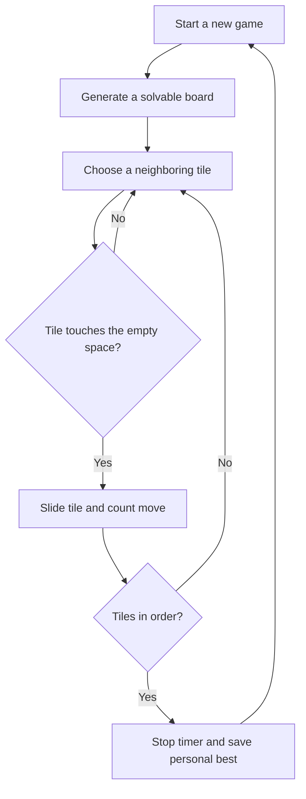

# Tile Shift

A small, neon-lit 15-puzzle for curious minds. Put the numbered tiles back in order, make every move count, and try to set a new personal best.

**Play:** [oscarmmi.github.io/sliding-puzzle](https://oscarmmi.github.io/sliding-puzzle/)

## How to play

- Tap or click a tile next to the empty space to slide it.
- Use the arrow keys to slide the adjacent tile from that direction into the empty space.
- Press **R** or choose **New shuffle** for another solvable board.
- Arrange tiles **01–15** in row-major order with the empty space at the end.
- Your move count and timer track each run. Your fewest-move win is saved in this browser.

## Run locally

```sh
npm install
npm run dev
```

Run the puzzle logic tests and production build with:

```sh
npm test
npm run build
```

## Game loop



## Built with

Vue 3, TypeScript, Vite, and Vitest. The tile patterns and color system are original CSS artwork; no backend or licensed logos are used.
